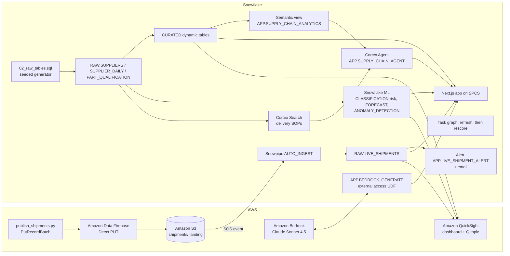

# Malaysia Semiconductor Supplier Delivery Risk

Supplier delivery analytics for **40 component suppliers in a fictional semiconductor assembly and test supply chain across 8 Malaysian cities** (Bayan Lepas, Kulim, Ipoh, Shah Alam, Seremban, Melaka, Senai and Kuching) and 5 material categories: bonding wire, lead frames, substrates, specialty chemicals and test consumables. Each inbound shipment from a supplier to an assembly and test plant either arrives by the purchase-order commit date or it does not. Built on Snowflake, optionally with AWS, the demo turns those shipments into on-time delivery KPIs, a 7-day delivery-miss risk score per supplier, a shipment alert email and an AI action memo for the head of supplier management. Exception checks are demo signals on synthetic data, not supplier audit or qualification verdicts.

## Architecture

A supplier delivery pipeline built on **Snowflake** (Dynamic Tables, Snowflake ML, Cortex Search, Cortex Agent, Cortex AI_COMPLETE, SPCS) and, in the full build, **AWS** (Amazon Data Firehose, Amazon S3, Bedrock Claude, QuickSight + Amazon Q). Inbound-shipment events land in `RAW.LIVE_SHIPMENTS`. Dynamic tables curate 90 days of supplier-day history: inbound shipments and units shipped, units received on time, delivery exception flags, confirmed delivery misses, lots quarantined at receiving, supplier performance reviews and second-source coverage. Snowflake ML scores 7-day delivery-miss risk per supplier, forecasts network-wide inbound shipments and flags ASN quantity variance anomalies. A Cortex Agent answers questions with SOP citations, and an LLM drafts the action memo.

Interactive diagrams (hover for object names): [Snowflake only](docs/architecture-snowflake.html) | [AWS + Snowflake](docs/architecture-aws.html). The app shows both on its Architecture & Data tab, the current build first. Regenerate them with `python3 docs/build_architecture.py aws snowflake`.



The Snowflake-only build drops the AWS subgraph: `APP.SIMULATE_SHIPMENTS` writes to `RAW.LIVE_SHIPMENTS`, and the app calls Cortex `AI_COMPLETE` instead of the Bedrock UDF.

## Snowflake Capabilities

| Capability | Implementation |
|-----------|---------------|
| Dynamic Tables | `CURATED.KPI_SUMMARY`, `PERFORMANCE_SUMMARY`, `SIGNAL_SUMMARY`, `TREND_ANALYSIS` from the RAW tables |
| Snowflake ML | CLASSIFICATION 7-day delivery-miss risk (`ML.DELIVERY_RISK_SCORES`), 14-day inbound shipment FORECAST, ASN quantity variance ANOMALY_DETECTION |
| Cortex Search | 11 synthetic delivery-exception follow-up SOPs (one per material category and exception signal) in `SEARCH.DELIVERY_SOP_SEARCH` |
| Semantic View | `APP.SUPPLY_CHAIN_ANALYTICS` over suppliers, exception signals, daily totals and risk |
| Cortex Agent | `APP.SUPPLY_CHAIN_AGENT`: Cortex Analyst over the semantic view plus Cortex Search for SOP citations |
| Cortex AI | `AI_COMPLETE('claude-sonnet-4-5')` for grounded answers, and for the action memo in the Snowflake-only build |
| Alerts + Tasks | `APP.LIVE_SHIPMENT_ALERT` logs FLAG events and sends email; task graph `TASK_REFRESH_CURATED`, then `TASK_RESCORE_RISK` |
| Snowpark Container Services | Next.js app `APP.MY_SEMICONDUCTOR_SUPPLY_CHAIN_APP` with 6 tabs: Executive Cockpit, Predictive, Supplier Reviews, Live Shipments, Ask AI, Architecture & Data |
| Snowpipe | `RAW.LIVE_SHIPMENTS_PIPE` AUTO_INGEST from S3 (AWS build only) |

## AWS Services

Used only in the AWS + Snowflake build.

| Service | Role in Demo |
|---------|-------------|
| Amazon Data Firehose | Direct PUT stream `my-semiconductor-supply-chain-shipments`: `aws/publish_shipments.py` sends inbound-shipment events with PutRecordBatch; Firehose buffers up to 60 s or 1 MB and writes newline-delimited JSON to S3 |
| Amazon S3 | Landing bucket (`shipments/`). An event notification goes to the Snowpipe SQS queue; Firehose errors go to `firehose-errors/` |
| Amazon Bedrock | Claude Sonnet 4.5 writes the action memo, called from Snowflake through an external-access UDF |
| Amazon QuickSight | DIRECT_QUERY executive dashboard over Snowflake (daily inbound shipments and exception flags, confirmed delivery misses by supplier, delivery-miss risk) |
| Amazon Q | Natural-language questions over the QuickSight topic `my-semiconductor-supply-chain-topic` |
| AWS IAM | Least-privilege roles for Snowflake S3 reads and Firehose S3 writes, and a Bedrock-only invoke user |

## Personas

These personas are fictional.

| Persona | Role | Key Questions |
|---------|------|---------------|
| **Farah Aziz** | Head of Supplier Management | "How much of what our suppliers shipped arrived on time, by material category?" "Which exception signals lead to confirmed delivery misses?" |
| **Daniel Lee Kah Wai** | Supplier Quality Engineer | "Which suppliers are high risk this week, and which SOP applies?" |

## Data

All data is synthetic and seeded, so every rebuild reproduces it. The supply chain, suppliers, plants and names are fictional; the cities are real places used only as labels, and nothing here describes a real company or site.

| Table | Rows | Description |
|-------|------|-------------|
| RAW.SUPPLIERS | 40 | Suppliers: every combination of 8 cities and 5 material categories (bonding wire, lead frame, substrate, specialty chemicals, test consumables), with risk tier, years in the supplier development programme and size |
| RAW.SUPPLIER_DAILY | 3,600 | Daily supplier observations over 90 days: inbound shipments, thousand units shipped and received on time, delivery exception flags, confirmed delivery misses, lots quarantined, exception signal, supplier performance reviews due and completed, ASN quantity variance and late share. Includes two area-wide customs clearance system outage days (Kulim and Senai) |
| RAW.PART_QUALIFICATION | 40 | Active part numbers, parts with a qualified second source on file and second-source qualifications pending per supplier |
| SEARCH.DELIVERY_SOP_DOCS | 11 | Synthetic delivery-exception follow-up SOPs indexed for Cortex Search (not supplier audit or qualification guidance) |
| RAW.LIVE_SHIPMENTS | Grows during the demo | Live inbound-shipment events from Firehose and S3 (AWS build) or `APP.SIMULATE_SHIPMENTS` (Snowflake-only build) |
| ML.DELIVERY_RISK_SCORES | 40 | 7-day delivery-miss probability and risk band per supplier |

## Build Instructions

### Prerequisites
- Snowflake account with ACCOUNTADMIN access, and Cortex AI enabled (AI_COMPLETE, Search, Agent).
- An X-Small warehouse with auto-suspend at or below 120 s, and an existing SPCS compute pool.
- Python 3.11+, `snowflake-connector-python`, Node.js 22+, Docker and the `snow` CLI.
- App image: run `snow spcs image-registry login`, then build and push `my-semiconductor-supply-chain-app:v1` to the database's `APP.IMAGES` repository (see the header of `snowflake/07_deploy_app.sql`).
- AWS build only: `boto3`, AWS credentials for the target account (us-west-2) with Firehose and Bedrock access, and QuickSight Enterprise.

### SPCS App
```
<DATABASE>.APP.MY_SEMICONDUCTOR_SUPPLY_CHAIN_APP
```

### Tests
```bash
python -m pytest aws snowflake quicksight
```

For a local run, put `SNOWFLAKE_ACCOUNT`, `SNOWFLAKE_USER`, `SNOWFLAKE_DATABASE`, `SNOWFLAKE_WAREHOUSE`, `SNOWFLAKE_AUTHENTICATOR=PROGRAMMATIC_ACCESS_TOKEN`, `SNOWFLAKE_TOKEN` and `DEMO_PLATFORM` in the environment, then run `npm --prefix app run build && npm --prefix app start`.

## Build Modes

Both modes share the same core. They differ in three places, and the app's `DEMO_PLATFORM` setting (in its SPCS spec) switches the memo provider and the Live Shipments tab.

| Layer | Snowflake Only | Full AWS + Snowflake |
|---|---|---|
| Live shipments | `CALL APP.SIMULATE_SHIPMENTS(n)` inserts simulated inbound-shipment events into `RAW.LIVE_SHIPMENTS`. This simulates a supplier shipment feed; it is not Snowpipe Streaming | `aws/publish_shipments.py` sends inbound-shipment events to Amazon Data Firehose, which writes them to S3, then SQS and Snowpipe AUTO_INGEST |
| Action memo | Cortex `AI_COMPLETE('claude-sonnet-4-5')` | Amazon Bedrock Claude Sonnet 4.5 through `APP.BEDROCK_GENERATE` |
| BI and natural-language questions | The SPCS app is the dashboard; questions go to the Cortex Agent | Also a QuickSight dashboard and an Amazon Q topic |
| App setting | `DEMO_PLATFORM: snowflake` | `DEMO_PLATFORM: aws` |

### Snowflake Only

```bash
# 1. Core data and dynamic tables (guarded: new isolated database only)
python snowflake/run_core.py --database MALAYSIA_SEMICONDUCTOR_SUPPLY_CHAIN_SNOWFLAKE --warehouse <XS_WAREHOUSE> --connection <CONNECTION> --apply
# 2. Native inbound-shipment feed, ML, search, semantic view, agent, alert and task graph
python snowflake/run_intelligence.py --database MALAYSIA_SEMICONDUCTOR_SUPPLY_CHAIN_SNOWFLAKE --platform snowflake --warehouse <XS_WAREHOUSE> --connection <CONNECTION> --alert-email <ALERT_EMAIL>
# 3. App on SPCS with DEMO_PLATFORM=snowflake (push the image first)
python snowflake/run_intelligence.py --database MALAYSIA_SEMICONDUCTOR_SUPPLY_CHAIN_SNOWFLAKE --platform snowflake --warehouse <XS_WAREHOUSE> --connection <CONNECTION> --alert-email <ALERT_EMAIL> --files 07_deploy_app.sql --compute-pool <COMPUTE_POOL>
```

During the demo:
- Run `CALL APP.SIMULATE_SHIPMENTS(20)` to add live inbound-shipment events. For a continuous feed, run `ALTER TASK APP.TASK_SIMULATE_SHIPMENTS RESUME`, and `SUSPEND` it afterwards.
- Run `EXECUTE ALERT APP.LIVE_SHIPMENT_ALERT` to raise the shipment alert email.
- Run `EXECUTE TASK APP.TASK_REFRESH_CURATED` to refresh the curated tables and rescore delivery-miss risk.

Afterwards, drop the database or run `ALTER SERVICE APP.MY_SEMICONDUCTOR_SUPPLY_CHAIN_APP SUSPEND`.

### Full AWS + Snowflake

```bash
# 1. Core data and dynamic tables (guarded: new isolated database only)
python snowflake/run_core.py --database MALAYSIA_SEMICONDUCTOR_SUPPLY_CHAIN_AWS --warehouse <XS_WAREHOUSE> --connection <CONNECTION> --apply
# 2. AWS ingestion and Bedrock (dry run first, then --apply)
python aws/setup_aws.py --database MALAYSIA_SEMICONDUCTOR_SUPPLY_CHAIN_AWS --account <AWS_ACCOUNT_ID> --connection <CONNECTION> --apply
# 3. ML, search, semantic view, agent, alert and task graph
python snowflake/run_intelligence.py --database MALAYSIA_SEMICONDUCTOR_SUPPLY_CHAIN_AWS --platform aws --warehouse <XS_WAREHOUSE> --connection <CONNECTION> --alert-email <ALERT_EMAIL>
# 4. App on SPCS with DEMO_PLATFORM=aws (push the image first)
python snowflake/run_intelligence.py --database MALAYSIA_SEMICONDUCTOR_SUPPLY_CHAIN_AWS --platform aws --warehouse <XS_WAREHOUSE> --connection <CONNECTION> --alert-email <ALERT_EMAIL> --files 07_deploy_app.sql --compute-pool <COMPUTE_POOL>
# 5. QuickSight dashboard and Q topic (needs an existing Snowflake data source)
python quicksight/build_dashboards.py --database MALAYSIA_SEMICONDUCTOR_SUPPLY_CHAIN_AWS --account <AWS_ACCOUNT_ID> --principal-arn <QUICKSIGHT_USER_ARN> --data-source-arn <DATA_SOURCE_ARN> --prefix my-semiconductor-supply-chain --apply --update --with-topic
```

QuickSight objects must be shared with the QuickSight user who signs in (`--principal-arn`); otherwise the console shows nothing.

During the demo:
- Run `python aws/publish_shipments.py --count 20` to send a batch of live inbound-shipment events to Firehose. Firehose delivers them to S3 within about 60 seconds, and Snowpipe loads them shortly after.
- Run `EXECUTE ALERT APP.LIVE_SHIPMENT_ALERT` to raise the shipment alert email.
- Run `EXECUTE TASK APP.TASK_REFRESH_CURATED` to refresh the curated tables and rescore delivery-miss risk.

Afterwards, `python aws/teardown_aws.py --database MALAYSIA_SEMICONDUCTOR_SUPPLY_CHAIN_AWS --account <AWS_ACCOUNT_ID> --connection <CONNECTION> --apply` removes the AWS resources (Firehose stream, bucket, roles, Bedrock user) and the account-level Bedrock external-access and S3 storage integrations. It leaves the email integration `MY_SEMICONDUCTOR_SUPPLY_CHAIN_EMAIL_INT`, which the Snowflake-only build also uses.

## Business Impact

Policy context and Snowflake customer outcomes:
- **Malaysia's National Semiconductor Strategy (NSS) is to be implemented in three phases over the next 10 years**, starting with modernising outsourced semiconductor assembly and test (OSAT) -- [MIDA: National Semiconductor Strategy to guide industry up value chain](https://www.mida.gov.my/mida-news/national-semiconductor-strategy-to-guide-industry-up-value-chain/)
- **RM25 billion has been allocated as targeted incentives to implement the NSS** -- [MIDA: National Semiconductor Strategy to guide industry up value chain](https://www.mida.gov.my/mida-news/national-semiconductor-strategy-to-guide-industry-up-value-chain/)
- **Honeywell** (Snowflake customer) transitioned from managing 33 separate enterprise data warehouses to a unified Snowflake AI Data Cloud, which has improved its ability to manage a complex supply chain with millions of SKUs and thousands of suppliers -- [Snowflake customer story: Honeywell](https://www.snowflake.com/en/customers/all-customers/video/honeywell/)

## Key Demo Numbers

These figures are synthetic and come from the seeded demo data. Forecast and anomaly figures can shift slightly with the build day.

- **40 suppliers** (8 cities x 5 material categories), 3,600 supplier-days over 90 days: **22,183 inbound shipments** and 828.7 million units shipped, with **86.4% of units on time**. Bonding wire suppliers are most punctual (92.2%) and substrate suppliers least (79.3%)
- **548 delivery exception flags** and **110 confirmed delivery misses**, so flag precision is 20.1%; **52 lots** quarantined at receiving. The supplier with the most confirmed misses is SUP-0018 Ipoh Substrate supplier (16)
- **Commit date slipped** produces the most confirmed misses (33 of 120 flags); the 10 customs clearance system outage flags are never confirmed
- **Delivery-miss risk model** out-of-time holdout (600 supplier-days): precision 0.38, recall 0.13 at a 0.5 threshold, against a 0.21 base rate. Five suppliers are high risk; the top one is SUP-0018 Ipoh Substrate supplier, at 90.0%
- **14-day inbound shipment forecast** of about 246 shipments per day, with prediction intervals; **58 of 640** supplier-days flagged as ASN quantity variance anomalies
- **Supplier review completion 79.2%**, second-source coverage 60.2% of 5,557 active part numbers, with 503 second-source qualifications pending
- **11 SOPs** indexed for Cortex Search and cited by ID in agent answers

## License

Apache 2.0 — See [LICENSE](LICENSE) for details.

This is a personal demo project and is not an official Snowflake offering. It comes with no support or warranty. It is not procurement, audit or investment advice. Policy statements are taken from the cited MIDA page, and customer outcomes from the cited Snowflake customer story; they are not guarantees of results.
